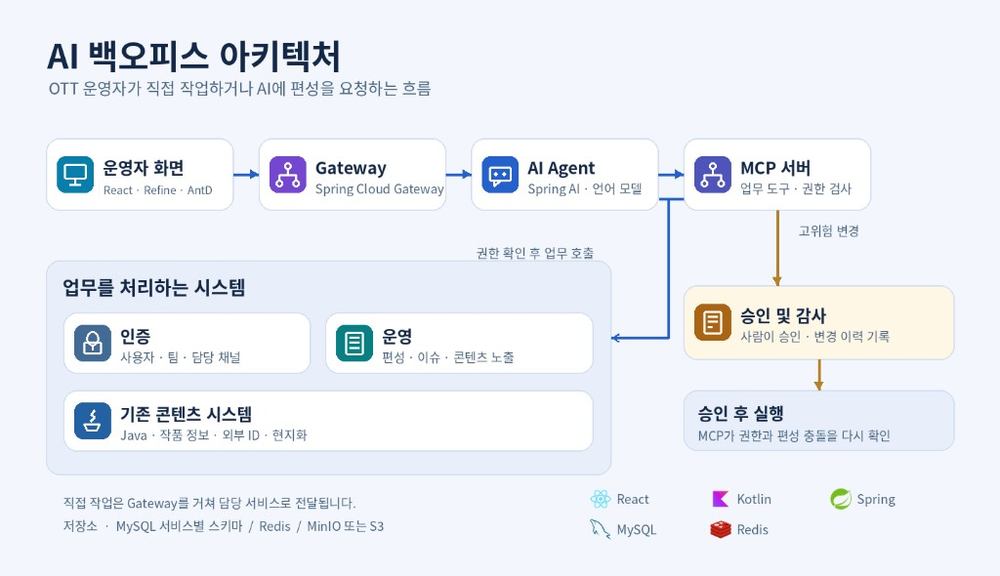
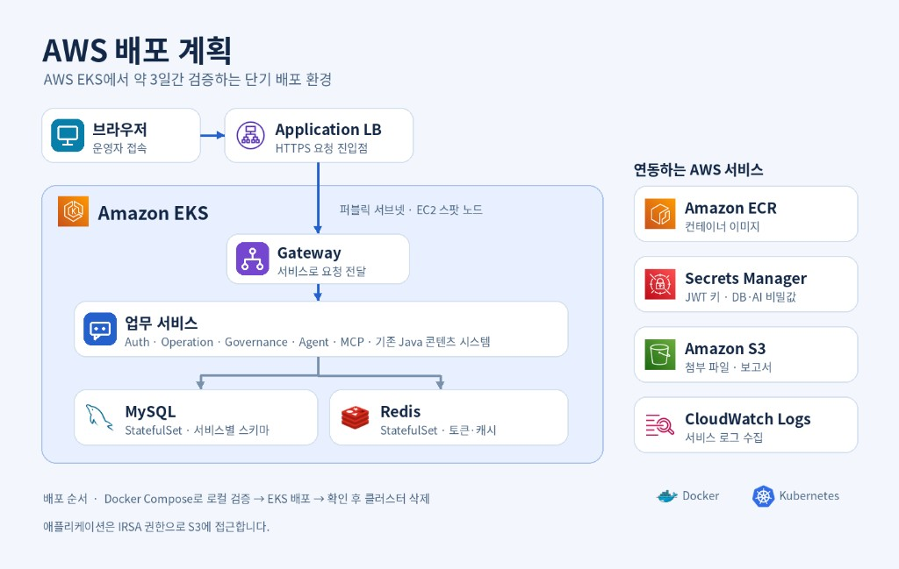

# AI Backoffice Platform

콘텐츠 운영 메타데이터를 다루는 백오피스입니다.
화면에서 직접 일하거나, 오른쪽 채팅창에 말로 시킵니다.
사람과 AI는 같은 권한으로 일하고, 위험한 변경은 승인 뒤에만 실행됩니다.



## 무엇을 하는 화면인가

```
로그인  →  작품·편성 화면  →  직접 수정 또는 [말로 시키기]  →  위험하면 승인 요청  →  승인 후 실행
역할별 메뉴    목록·상세·주간표      같은 권한의 툴만 호출         게시·숨김            권한·충돌 재확인
```

1. **로그인** — 역할에 맞는 메뉴와 버튼만 보인다.
2. **콘텐츠** — 작품을 찾고, 외부 ID와 언어별 제목·줄거리를 본다. TMDB 후보 연결은 요청으로 올린다.
3. **편성** — 채널 주간표에서 초안을 만들고, 시간이 겹치면 표시한다. 게시는 바로 하지 않고 승인 요청만 한다.
4. **말로 시키기** — 채팅이 툴을 호출한 과정과 결과를 카드로 보여 준다. 승인이 필요하면 승인 요청 번호만 답한다.
5. **승인** — 사람이 바뀔 값을 보고 승인하거나 반려한다. AI에게는 승인·반려 툴을 주지 않는다.

| 하는 일 | 바로 실행 | 승인 뒤 실행 |
| --- | --- | --- |
| 작품 조회, 편성 초안, 충돌 확인 | 권한 안이면 실행 | |
| 외부 ID 연결, 현지화 수정, TMDB 반영 | | 콘텐츠 운영 권한 + 승인 |
| 편성 게시, 작품 숨김 | | 담당 채널이 같고, 자기 요청은 승인 불가 |

편성은 담당 채널 안에서만 다룬다. 승인 직전에 권한과 충돌을 다시 확인하고, 같은 승인은 한 번만 실행한다.

## 메뉴

화면 주소는 `/bo`부터 시작한다.

| 메뉴 | 주소 | 하는 일 | 상태 |
| --- | --- | --- | --- |
| 로그인 | `/bo/login` | 이메일과 비밀번호 | 화면 있음 |
| 대시보드 | `/bo` | 승인 대기, 오늘 편성, 열린 이슈, 최근 AI 실행 | 화면 있음 |
| 콘텐츠 | `/bo/contents` | 작품 목록·상세, TMDB 후보 | 화면 있음 |
| 편성 | `/bo/schedule` | 주간 편성표, 초안, 충돌, 게시 요청 | 화면 있음. 일부만 동작 |
| AI 채팅 | 모든 화면 오른쪽 | 지시, 툴 카드, 승인 대기 카드 | 화면만 있음 |
| 이슈 | `/bo/issues` | 접수, 댓글, 숨김 요청 | 아직 없음 |
| 승인함 | `/bo/approvals` | 바뀔 값 비교, 승인·반려 | 아직 없음 |
| 감사 로그 | `/bo/audit` | 사람·AI·툴·기간으로 찾기 | 아직 없음 |
| 툴 정책 | 관리자 | 툴별 위험도와 필요 권한 | 아직 없음 |

## 요청이 지나가는 길



```
브라우저 → gateway → auth · operation · governance · agent
                              agent → mcp-server → 권한·정책 확인
                                              → 위험하면 governance에 승인 요청
                                              → 통과하면 operation 또는 content-meta
```

| 서비스 | 하는 일 |
| --- | --- |
| gateway | 로그인 토큰을 확인하고 알맞은 서비스로 보낸다. 서비스끼리만 쓰는 주소는 밖에서 막는다 |
| auth | 로그인, 역할, 담당 채널 |
| operation | 편성, 이슈, 작품 숨김 |
| governance | 툴 정책, 승인, 감사 기록 |
| agent | 대화. 툴 호출은 한 번에 8번까지 |
| mcp-server | AI가 쓸 수 있는 툴만 연다. 부를 때마다 권한과 정책을 본다 |
| content-meta | 작품, 외부 ID, 언어별 제목과 줄거리. 백오피스는 이 API로 조회하고 반영을 요청한다 |

서비스끼리는 REST로만 호출한다. MySQL은 하나고 스키마는 서비스마다 나뉜다. 감사 기록은 각 서비스 DB에 먼저 남기고, 나중에 governance로 모은다. governance가 잠시 멈춰도 기록이 빠지지 않게 하려는 것이다.

권한은 두 번 본다. mcp-server가 한 번, operation이 자기 API에서 한 번 더. 채팅을 거치지 않은 호출도 같은 규칙을 타게 하려는 것이다.

작품 숨김은 operation에 따로 둔다. 작품 메타데이터의 검증 결과와 섞이지 않게 하려는 것이다.

## 정한 것

- **로그인 토큰은 RS256**이다. 서명 열쇠는 auth만 가진다. 열쇠가 한 곳에 있어야 위조를 막기 쉽다.
- **모델과 툴 선택은 화면이 하지 않는다.** 시킨 사람의 권한과 툴 정책 중 더 좁은 쪽만 통과한다.
- **서버 코드는 서비스마다 같다.** `presentation → application → domain → infrastructure`.

## 폴더

```text
backend/
├── build.gradle, src/         content-meta. 작품 메타데이터 Java 서비스
├── aibo-framework/            오류 코드, 로그인 확인, 감사 기록 공통 코드
├── aibo-gateway/
├── aibo-module-auth/          -api / -server
├── aibo-module-operation/
├── aibo-module-governance/
├── aibo-module-mcp/
└── aibo-module-agent/

frontend/src/backoffice/      /bo 화면
├── platform/                  로그인, 권한별 버튼, 서버 호출, AI 스트림
├── components/chat/
└── views/                     login, dashboard, content, schedule
```

## 진행

| 단계 | 내용 | 상태 |
| --- | --- | --- |
| 0 | 모듈 구성, 서비스별 데이터베이스 설계, 화면 일부 | 모듈 빌드는 컴파일까지 통과. 화면은 로그인·대시보드·콘텐츠·편성 |
| 1 | auth, 공통 모듈, gateway | 다음 |
| 2 | operation, 감사 기록 전송 | 예정 |
| 3 | governance. 승인·툴 정책 | 예정 |
| 4 | mcp-server | 예정 |
| 5 | agent | 예정 |
| 6 | 이슈, 승인함, 감사 로그 화면 | 예정 |
| 7 | AWS EKS 배포 | 예정. 구성은 위 그림 |

서비스 기능 테스트는 아직 돌리지 않았다. 기능을 넣으면서 Testcontainers MySQL로 확인한다.

## 기술

| 영역 | 사용 |
| --- | --- |
| 언어 | Kotlin, JDK 21. content-meta는 Java 21 |
| 백엔드 | Spring Boot, Spring Security, Spring Data JPA, Flyway |
| 게이트웨이 | Spring Cloud Gateway |
| AI | Spring AI, MCP |
| 저장소 | MySQL 8, Redis, 파일은 로컬 MinIO / 운영 S3 |
| 프론트 | React, Refine, Ant Design, TypeScript, Vite |
| 배포 | Docker, AWS EKS, ECR, ALB, Secrets Manager, CloudWatch |
